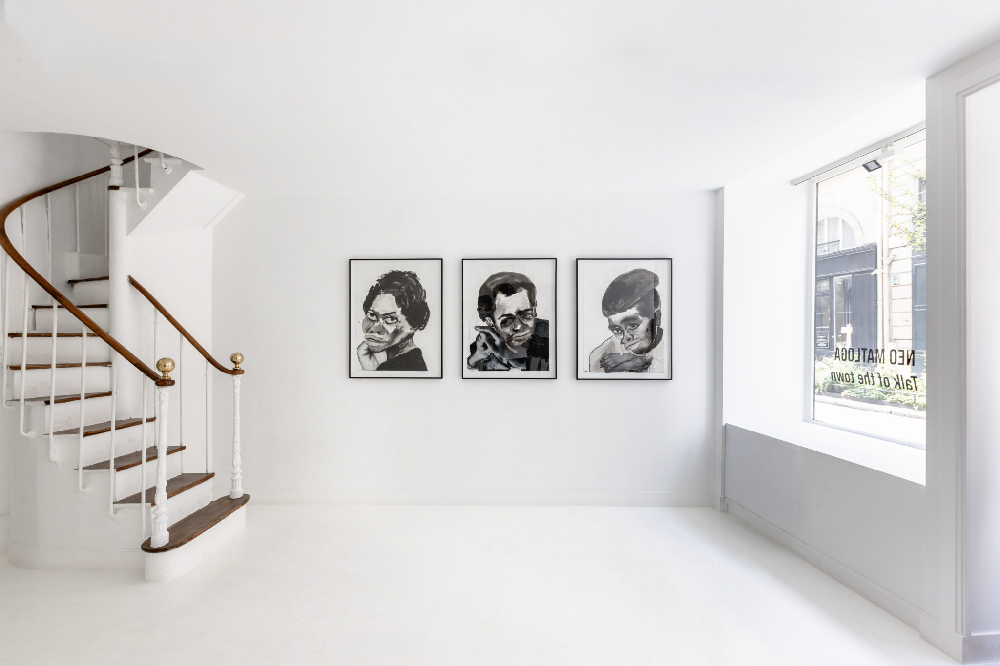
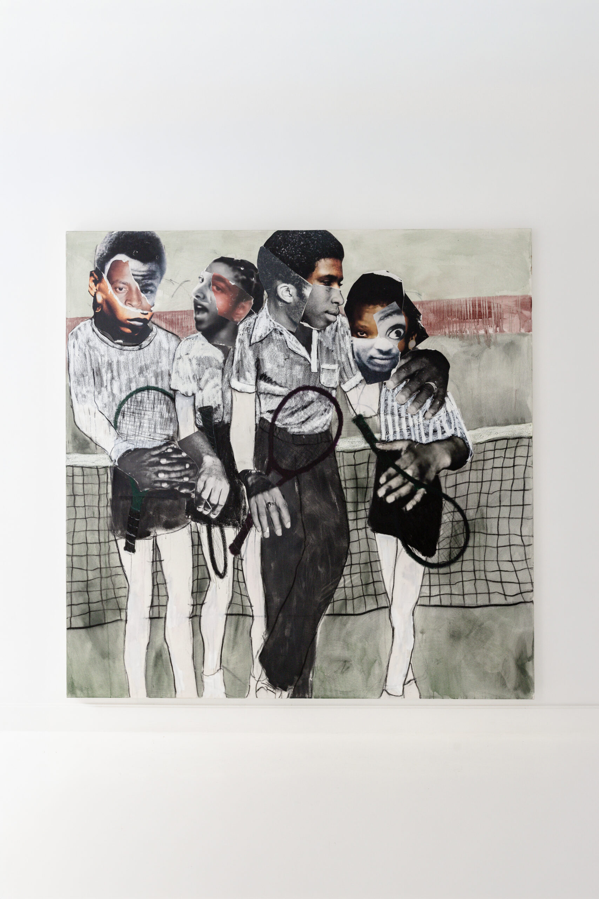

Avec le contexte actuel, on ne peut nier que la répression policière et la question des violences policières occupent une place majeure dans le débat public. Mais à travers quelques œuvres que je voulais vous présenter, nous pouvons avoir une analyse plus fine de la répression exercée par l'État de manière générale et découvrir qu’elle ne date pas d’hier. 

### <em>La Charge</em> — André Devambez

Comment ne pas parler des charges policières ? Si elles peuvent être légitimes en théorie, que dire lorsqu’elles visent des étudiants assis ou des manifestants volontairement nassés ? La charge est une technique ancienne utilisée pour repousser un groupe de manifestants. Cette peinture s’inscrit dans le contexte de la fin des années 1890, marqué par la montée des violences lors des affrontements entre la police et les manifestants. Ces derniers sont le plus souvent des mineurs ou des ouvriers qui s’opposent au pouvoir en place à travers leurs manifestations ou des grèves insurrectionnelles. Ces tensions atteignent notamment un pic de violence le 1er mai 1891, lorsque l’armée ouvre le feu sur des travailleurs à Fourmies, faisant plusieurs morts et blessés. Cette représentation d’une manifestation nocturne tranche avec notre imaginaire collectif, mais correspond à une réalité sociale de l’époque. En effet, les manifestations avaient souvent lieu après la journée de travail des ouvriers. C’est dans ce contexte de violence institutionnelle que prend place la peinture La Charge. On ne sait pas exactement ce que revendiquent les manifestants représentés. Plusieurs hypothèses sont possibles : il pourrait s’agir de manifestants anarchistes, d’ouvriers ou encore de nationalistes antidreyfusards.

Cette composition représente la police chargeant des manifestants et tranche, pour l’époque, par son point de vue en contre-plongée. Celui-ci pourrait faire penser à une peinture moderne, alors que l’œuvre date de 1902. D’autre part, le contraste saisissant entre la lumière des cafés parisiens, des kiosques, des colonnes Morris et l’éclairage des vitrines tranche avec la noirceur de la police qui fond sur les manifestants. La composition s’articule autour d’une ligne de force diagonale qui permet de concentrer le regard du spectateur sur la confrontation entre la police et les manifestants. Devambez saisit le mouvement de la peur : une foule se disperse, une ligne de policiers avance, le vide se creuse entre eux. Cette composition oriente la circulation du regard et crée du dynamisme en laissant le centre du tableau vide, ce qui renforce l’effet de fuite. Elle crée également une tension plastique qui accentue le sentiment de peur suscité par la police et met en exergue la crainte d’une répression excessive.
# schéma anoté 

Enfin, soulevons une ambiguïté. Je vous présente cette œuvre comme une dénonciation des violences policières. Cependant, celle-ci a longtemps été exposée dans le bureau du préfet de police, qui l’appréciait énormément pour sa représentation du « maintien de l’ordre ». Cette vision du maintien de l’ordre, exclusivement fondée sur la peur et la répression du peuple, fièrement affichée par le préfet de police de l’époque, ne montre-t-elle pas une institution défaillante ?

### <em>Les Barricade</em> et <em>Guerre Civile</em> - mettre prénom Manet 
Ces œuvres s’inscrivent dans le contexte de la Commune de Paris. Après la défaite de la France face à la Prusse, un soulèvement éclate à Paris contre le gouvernement en place. Les insurgés prennent le contrôle de la ville, l’administrent et la font vivre de manière autonome, tout en défendant des idées novatrices pour l’époque. Cependant, l’armée régulière assiège la ville de Paris, avant d’y entrer en mai 1871. S’ensuit une terrible répression que Manet dénonce à travers ses œuvres. Les barricades occupent une place importante dans l’histoire de la Commune de Paris.

Ces deux lithographies se suivent et montrent différentes étapes de la répression de la Commune de Paris. La première représente l’exécution sommaire d’un communard par l’armée de Versailles. Une image violente, où l’on voit de nombreux soldats tirer sur des communards à bout portant, véritable symbole de violence. La composition de La Barricade n’est pas sans rappeler la peinture <em> Tres de Mayo de Goya</em> , qui condamne les exécutions de prisonniers espagnols commises par l’armée napoléonienne en Espagne en 1808.
# image tres de mayo 

La seconde représente des cadavres placés derrière une barricade conquise. Les corps des communards semblent se fondre dans le décor, aux côtés des barricades faites de pavés. Dans cette œuvre, la noirceur sert le propos critique et renforce la dureté de la scène. Le cadrage y joue pour beaucoup : un cadrage serré sur le corps d’un anonyme, abattu sommairement lors d’une répression violente et aveugle, renforce la brutalité de l’œuvre. Le cadavre se confond avec les débris, les tonneaux, la barricade et les autres corps que l’on peut apercevoir partiellement. Au pied de la barricade, le corps se mêle aux ruines. La répression semble avoir effacé jusqu’à la frontière entre les êtres et les débris.

### <em>Rue Transnonain, le 15 avril 1834</em>— Honoré Daumier
C’est l’œuvre principale qui a initié ma réflexion et que j’ai découverte grâce à la vidéo de Natures Peinture (j’adore leurs vidéos, allez les voir… quand vous aurez fini l’article, hein).

Quatre ans après la révolution de 1830, qui a porté Louis-Philippe au pouvoir et instauré la monarchie de Juillet, de nombreuses révoltes éclatent, notamment celle des canuts à Lyon, en avril 1834, qui sera réprimée dans le sang par le pouvoir en place. Malgré tout, la contestation gagne la ville de Paris. Dès lors, des barricades se mettent en place dans les rues de la capitale et la répression ne se fait pas attendre. Cependant, le 14 avril au soir, près d’une barricade de la rue Transnonain (actuelle rue Beaubourg), un coup de feu part d’un immeuble et blesse mortellement un officier. S’ensuit alors une terrible vengeance. Les soldats forcent la porte de l’immeuble, entrent et tuent tous ceux qu’ils trouvent sur leur passage. Femmes, enfants, vieillards : tout le monde subira la fureur des soldats. C’est ce drame de la répression aveugle et violente que vient dénoncer cette œuvre de Daumier.
# image des canuts 

La composition de l’artiste prend place dans une chambre à coucher et présente quatre figures : une femme, un enfant en bas âge, un vieillard et un ouvrier. Le réalisme de la scène renforce la portée presque juridique de cette œuvre, puisqu’elle sera publiée dans la presse de l’époque, accompagnée d’un texte visant à dénoncer les agissements des forces de l’ordre cette nuit-là. Cette lithographie représente, au premier plan, le corps sans vie d’un ouvrier encore en chemise de nuit. À travers le dessin de Daumier, on ressent tout le poids du corps de cet ouvrier, qui s’est effondré sur un enfant qu’il a écrasé dans sa chute. À droite, nous pouvons apercevoir le crâne d’un vieil homme, lui aussi victime innocente de cette « bavure ». Dans le fond, à gauche, nous pouvons voir une femme, elle aussi laissée sans vie. Tous ont été tués pendant leur sommeil, sans avoir de lien avec le meurtre de l’officier. Cette composition rentre dans l’intime de cette famille et vient montrer que même le plus innocent, ici le  nourrisson est taché de sang . Le calme apporté par le clair obscur de la scène vient trancher avec l’intense sauvagerie de celle-ci et les traces de sang laissés sur le sol d’une chambre familiale. Cet enchevêtrement de cadavres représente bien la folie aveugle qui a guidé les soldats ce soir du 14 avril 1834. 

À travers cette sélection d’œuvres, j’ai voulu montrer que l’art ne sert pas uniquement à être dégradé, sans que l’on prenne le temps de réfléchir à ce qu’il représente. Enfin, ces œuvres représentent des actes de répression en cours ou passés. Nous pouvons alors nous interroger sur ce qui est le plus marquant : l’acte lui-même ou la trace qu’il laisse. Ces trois ensembles d’œuvres permettent également de saisir l’étendue de la répression. Celle-ci passe d’un boulevard à une barricade, jusqu’à pénétrer dans une chambre. Il semble alors que personne ne soit à l’abri, puisque la violence ne connaît aucune frontière dans ces œuvres. Les violences policières traversent le débat public. Les œuvres que je vous propose de regarder en révèlent une profondeur historique : sous d’autres régimes, dans d’autres rues, les images ont déjà porté l’accusation.

L’art peut être utilisé pour véhiculer des messages et représenter des faits. Sa mission était d’autant plus importante lorsque la photographie n’était pas encore largement répandue. J’aurais bien évidemment pu parler de photographies représentant des bavures policières ou d’autres œuvres, telles que <em> Defacement (The Death of Michael Stewart)</em>  (1983) de Jean-Michel Basquiat, ou encore du travail de Yue Minjun.

Loam ADELAKOUN

