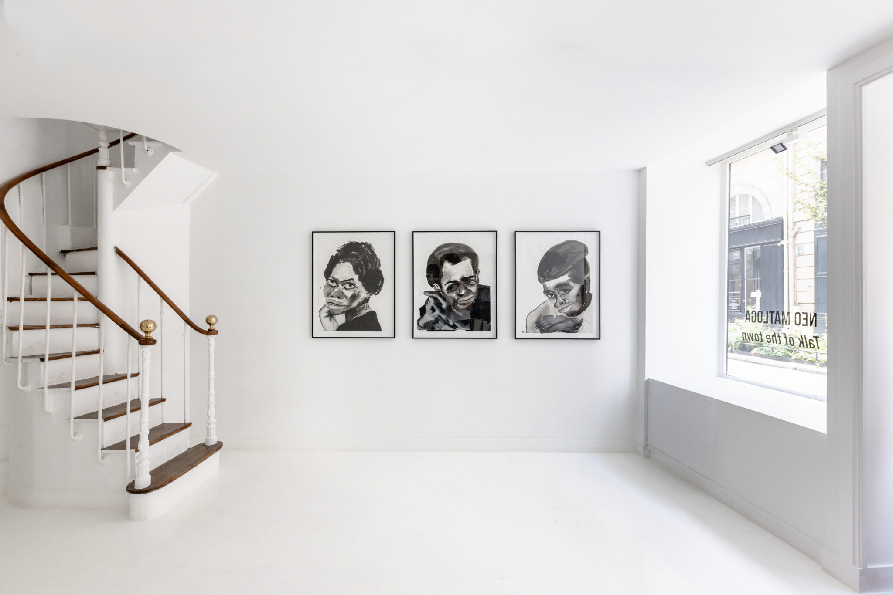
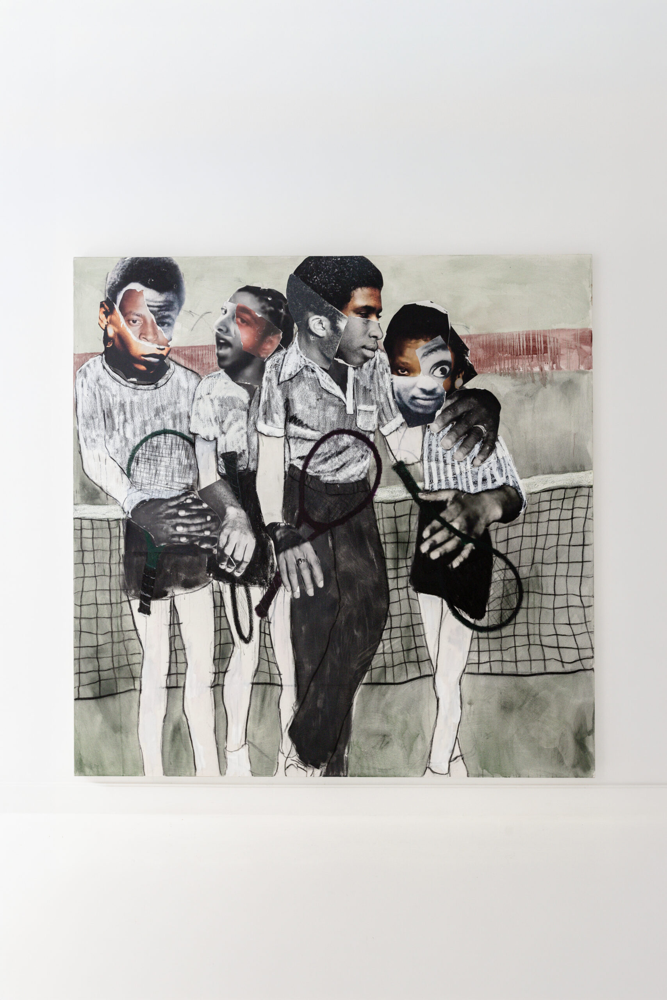

###### ceci est un article d'exmple sur une expositon 

### A la galerie Dagoma Harty 

Une histoire ne reste jamais intacte. Elle passe de bouche en bouche, perd un détail, en gagne un autre, déplace son sens à mesure qu’elle change de lieu. 
'''
C’est ce mécanisme de transmission — instable, vivant — que Neo Matloga emprunte au recueil de nouvelles de Fred Khumalo, Talk of the Town, pour donner son titre à cette exposition parisienne. Dans l’œuvre de Khumalo, la ville de Johannesburg se raconte elle-même à travers de multiples voix, souvent anonymes, qui se croisent sans se connaître. Matloga fait de la toile cet espace de croisement. Matloga connaît cette circulation de l’intérieur. Mamaila, Johannesburg, Amsterdam, et Recloses, un village de la forêt de Fontainebleau. Chaque lieu a sa propre manière de regarder et d’être regardé, ses propres codes sociaux, sa propre façon de faire circuler la rumeur.

###### Vous pouvez rajouter une légende comme ça 
Une histoire ne perd ou ne gagne pas seulement des détails en se déplaçant ; elle se reconfigure selon celui qui l’écoute et le lieu depuis lequel il la reçoit.
C’est à partir de cette expérience que le titre de l’exposition tire tout son sens : non pas un procédé emprunté à un livre, mais une condition que l’artiste a vécue.
Comme les nouvelles de Khumalo, ses images sont composites. Un visage prélevé dans une photographie de famille, un magazine ou une archive ; un corps redessiné au fusain ; un objet peint qui semble appartenir à un autre registre d’image. Rien n’est reproduit tel quel  tout est retraduit. Une photographie devient un portrait peint, un fragment devient un personnage à part entière, un vêtement ou un objet peut suffire à signaler une présence qui, elle, demeure hors champ.
Le collage et le marouflage ne relèvent pas ici d’un effet de surface : ils forment la structure même de l’image, rappelant qu’aucune figure ne vient d’un seul lieu ni d’une seule époque.

Les scènes choisies sont volontairement ordinaires : un bus, un court de tennis, une tasse de thé partagée, un regard qui croise le nôtre. Rien n’y est décisif. Mais c’est précisément dans ce rien que Matloga travaille dans l’écart entre deux corps, dans la direction d’un regard, dans le silence qu’une composition peut rendre presque audible. Cette économie du geste renvoie à une longue tradition picturale où la disposition des figures dans l’espace constitue un langage à part entière. Matloga reprend ce principe non pour raconter des scènes bibliques ou mythologiques, mais les gestes ordinaires d’une vie vécue entre plusieurs lieux.
Le récit, chez lui, ne se referme jamais. Il reste suspendu entre deux visages, entre ce qui est montré et ce qui est suggéré. C’est au spectateur qu’il revient de le compléter avec sa propre mémoire, ses propres associations, sa propre histoire.
Pour cette exposition, 11 œuvres convergent dans une nouvelle constellation. Venues d’ailleurs, elles nouent d’autres liens et, comme toute rumeur, n’attendent que d’être à nouveau mises en circulation.

 Galerie Dagoma Harty 

## Informations pratiques

- **Lieu :** Galerie Dagoma Harty 15, rue de Seine 75006 Paris
- **Horaires :** Du Mardi au Samedi 11H00-13H00 | 14H30-18H30
- **Entrée :** libre

