Avez-vous déjà ressenti ce silence particulier dans une galerie d'art, cet éclairage blanc et homogène, ce calme absolu qui, galerie après galerie, finit par vous sembler familier sans jamais vous appartenir? C’est précisément ce qui constitue le phénomène de white box attribué aux galeries d’art modernes depuis les années 1970. Tout d’abord le white cube/box n’est pas seulement un sentiment mais une réelle construction. Une galerie d’art avec ses 4 murs d’un blanc immaculé , un éclairage artificiel  provenant du plafond, l’absence d’éclairage naturel et son sol le plus souvent en béton ou un parquet c’est le schéma classique de la galerie d’art que nous retrouvons dans la plus part des pays que ce soit de Paris à Tokyo. Cette esthétique est devenue si représentative de l’art moderne que l'une des galeries les plus en vogue du monde actuellement ne nomme “white cube” étrange pour une galerie qui pratique le white cube. 

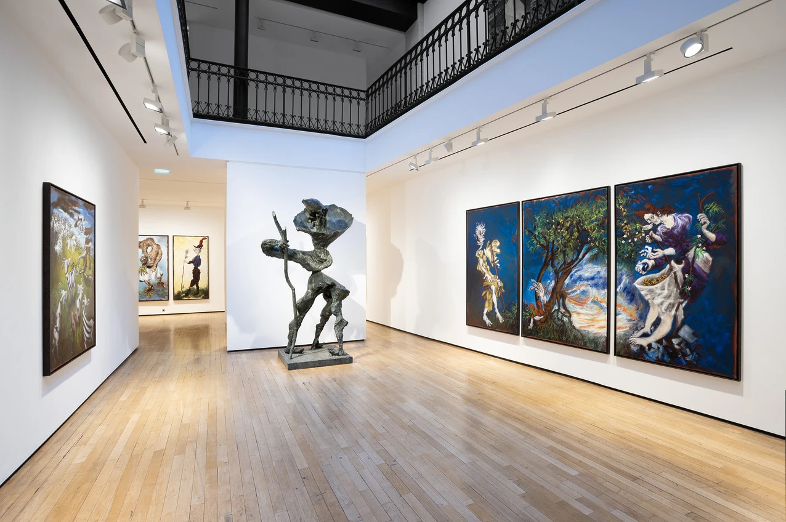

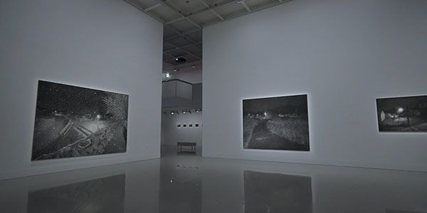

*Galerie Templon et Galerie Shiseido*

L’émergence de ces galeries entièrement blanches dès les années 1970 à mené à la théorisation de cette esthétique par le critique d’art Brian O'Doherty en 1976 dans <em>Inside the White Cube: The Ideology of the Gallery Space</em>.  La galerie dans un premier temps représente un espace hors du temps, et hors de la géographie conventionnelle  en effet la plupart des galeries ne possèdent pas de fenêtres et sont isolées visuellement en sonorement du milieu extérieur. Le lieu d’exposition de l’art n’est plus un simple lieu commun appartenant à une ville qui s'inscrit dans les changements continuels de la ville, sa transformation, son réaménagement, mais est un lieu hors de toute temporalité et de tout  changement, presque un lieu métaphysique.

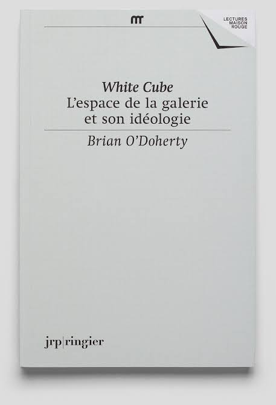

*Galerie Templon et Galerie Shiseido*

O'Doherty souligne également  la rigueur religieuse induite par la construction de galeries sur le modèle de white cube, qui vient sacraliser l’art.C’est ce que veut porter l’esthétique du white cube. En produisant un lieu d’exposition par essence inaltérable et commun à toutes les galeries. L'ensemble des galeries d’art entre dans une autre dimension non commune. Le white cube donne l’impression d’un endroit qui n’est pas éprouvé par le temps, et entrer dans une galerie c’est aussi avoir le privilège pour  soi-même pour une heure ou deux de ne plus subir le flot du temps. Rien ne doit interférer entre l'œuvre et son fidèle : le visiteur, converti avant même d'avoir regardé. D’autre part, ce phénomène permet de porter l‘art  comme un objet de consommation. En effet la consommation et le marché de l’art participent eux aussi au phénomène du white cube puisqu’en mettant l’art dans le white cube l’art devient un objet de convoitise qui est le seul qui peut être admiré dans la galerie. Ce n’est pas pour rien que les boutiques de luxe reprennent elles aussi les codes du white cube avec une esthétique très minimaliste, même lorsque la marque représente la créativité et une sorte d’innovation.

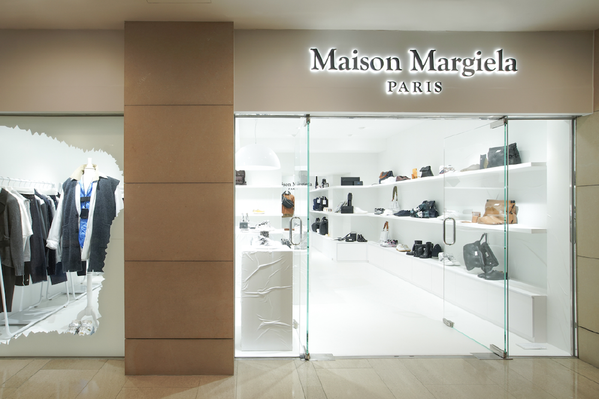

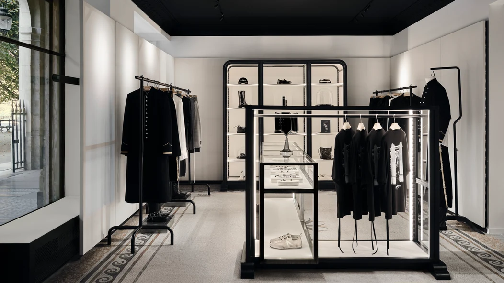

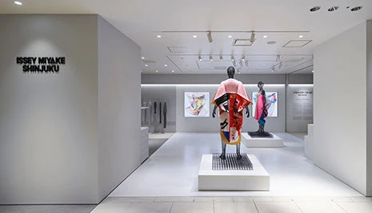

*Boutiques  Maison Margiela, Yohji Yamamoto, Anne Demeulemeester, Issey Miyake*

Le vide qui entoure l'œuvre n'est pas une absence : c'est une mise en scène, qui transforme le visiteur en acheteur potentiel sans qu'il s'en aperçoive. Enfin le regard du spectateur par l’instauration du white cube n’est plus libre le white cube vient à la fois formater l’oeuvres artistique mais aussi le regard du spectateur chez qui on impose une vision absolument épurée de l’art contemporain. Le silence de la galerie crée un visiteur silencieux incapable de réellement communiquer avec les autres visiteurs hors des vernissages. Et la presque sacralité émanente de ces murs blancs intimide le spectateur et le transforme en dévot incapable de remettre en cause la valeur du travail de l’artiste. Ce qui renforce l’emprise du white cube sur le marché de l’art puisque la légitimité et la valeur marchande de l'œuvre provient uniquement de sa présence dans une galerie de type white cube.  C’est  par cette emprise du regard du spectateur que le white cube est devenu incontournable dans le marché de l’art. 

### Certaines galeries et expositions diffèrent. 

Tout d’abord nous avons *Huile sur béton*  de Artemile allez voir mon article dessus. Une exposition sensible qui prend totalement vie dan un chnatier. 

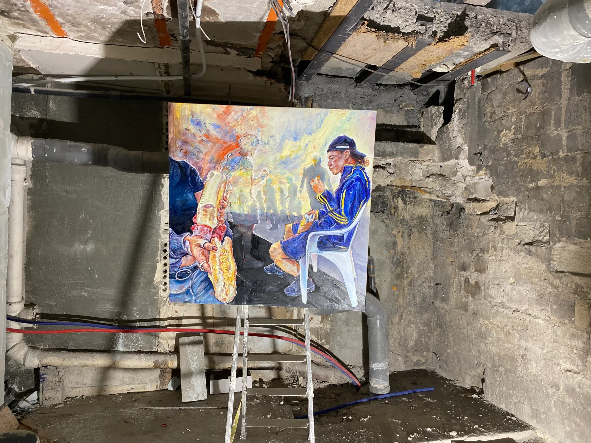

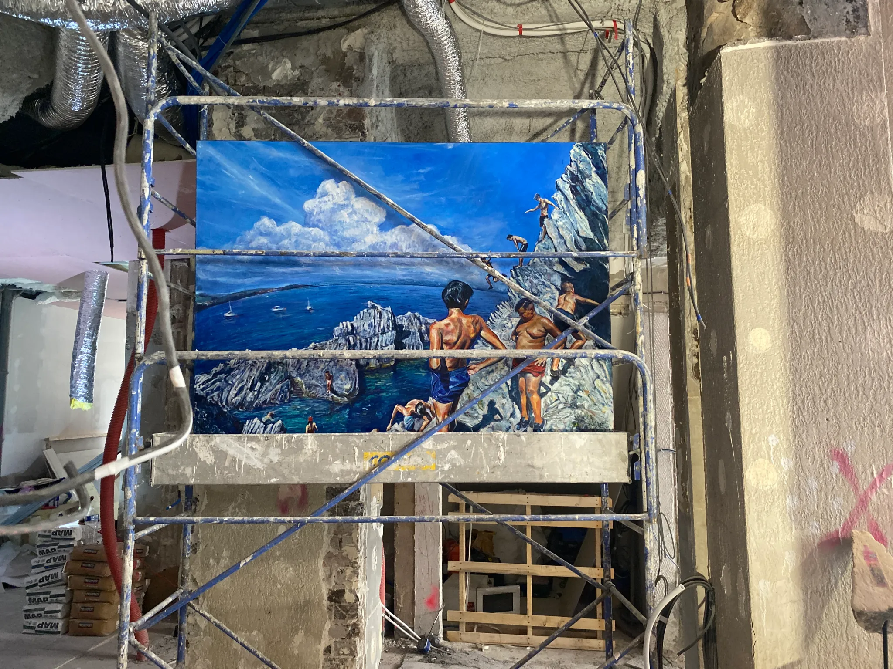

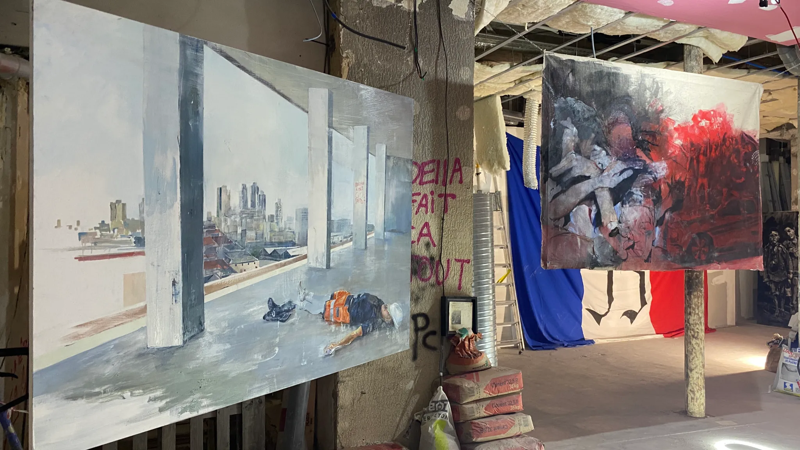

D’autres artistes tels que Abdelkader Benchamma tentent à travers leurs expositions de briser la simple convention du white cube en transformant le white cube en lui-même en réel terrain d’expression. La galerie continue à faire vivre l’art mais en devient aussi une partie de l'œuvre totale de l’artiste. 

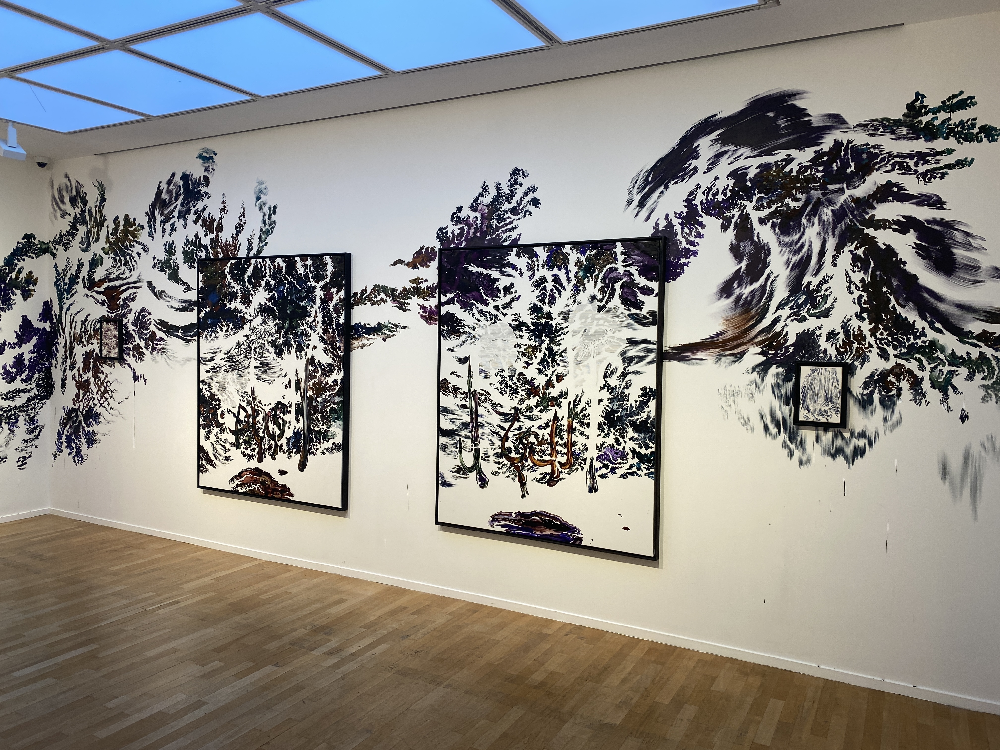

La galerie Fisheye de Paris qui reprend une partie des codes de la galerie au format white cube mais qui laisse apparaître un décors encore brut qui vient trancher avec l’homogénéité intrinsèque aux galeries d’art contemporaines.

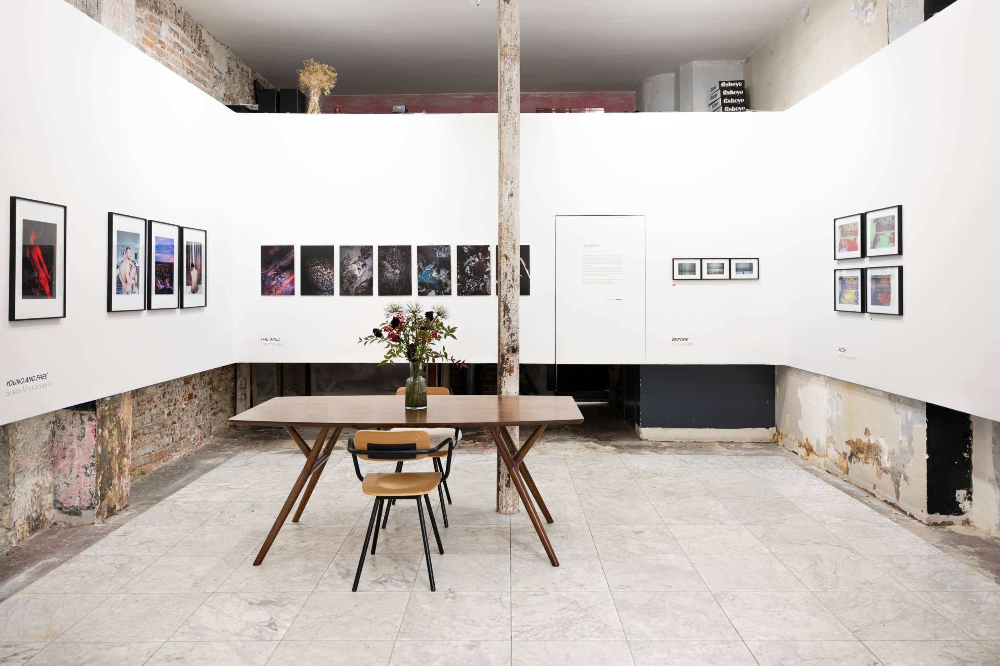
 

Personnellement je rejoins l’idée selon laquelle le white cube sert principalement le prestige de l’art moderne et la vente. Avoir un décor intemporel est une marque de prestige et permet de placer hors de la vie commune les œuvres. Le white cube est résolument élitiste  à travers un art contemporain qui se plaît à l'opacité ,à la difficulté d’accès. La récompense d’oser aimer l’art serait d'accéder à cette éternité de papier peint blanc.  il n’y que par ce moyen que nous pouvons nous échapper à l’emprise du temps et devenir “immortel”. Cependant, dès lors que la mode actuelle tend vers un minimalisme dans tous les domaines de notre vie quotidienne, la white box suffira-t-elle à conserver le prestige de l’art et à le distinguer de la vie commune. De plus avec la multiplication du nombre de galeries d’art peut être que nous assisterons à une différenciation des galeries d’art par leur décors et leur ambiance générale.  Enfin le white cube n’aura plus sa place dans les expositions temporaires.