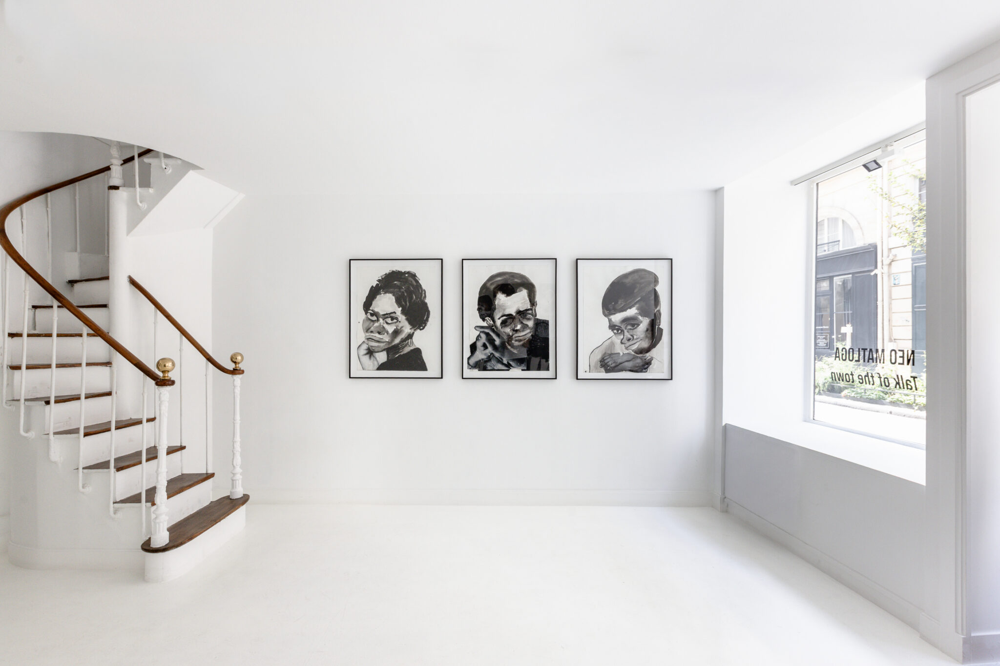
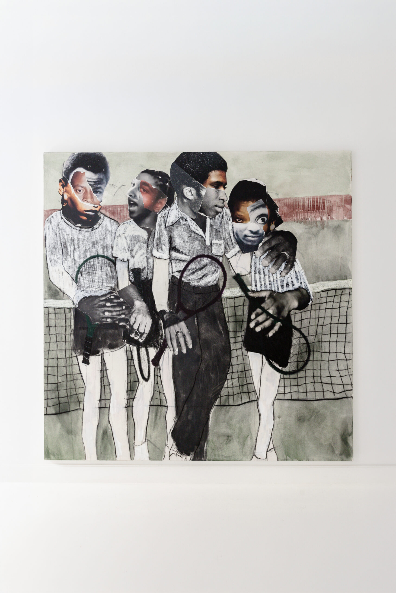
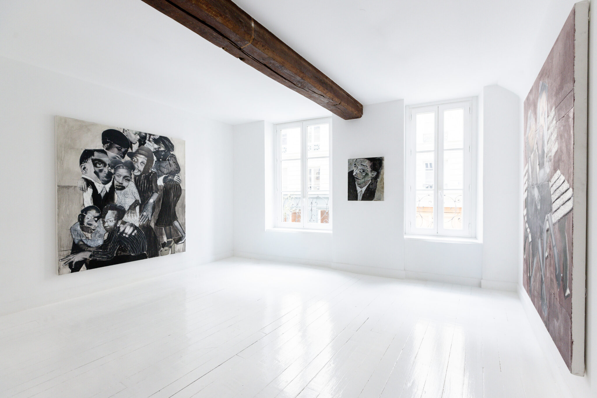

Une grande image à gauche, deux images superposées à droite, puis une photographie sur toute la largeur : voici la disposition en situation avec les photos de l’article [TALK OF THE TOWN](/blog/article_exemple/), consacré à la galerie Dagoma Harty.

<div class="image-mosaic image-mosaic--wide">








</div>

*Photographies reprises de l’article Dagoma Harty. La vue de la salle est utilisée deux fois pour illustrer les quatre emplacements.*

## Variante à trois images

Ajoutez la classe `image-mosaic--three` pour afficher une grande photo à gauche et deux photos superposées à droite, sans rangée supplémentaire en dessous.

<div class="image-mosaic image-mosaic--three image-mosaic--wide">


</div>

*Trois photographies de la galerie Dagoma Harty, dans l’ordre de lecture de la mosaïque.*

### Le bloc à copier pour trois images

```markdown
<div class="image-mosaic image-mosaic--three image-mosaic--wide">


</div>
```

Utilisez **exactement trois images** : la grande image à gauche, celle en haut à droite, puis celle en bas à droite. La classe `image-mosaic--wide` reste facultative : retirez-la pour garder la largeur de la colonne du texte.

## Reproduire la disposition à quatre images

Copiez ce bloc directement dans un fichier `.md` de `src/content/blog/`, à l’endroit où vous souhaitez afficher vos images. Remplacez les chemins et les descriptions par les vôtres. Le CSS est déjà chargé sur le site : aucun import ni composant n’est nécessaire dans l’article.

```markdown
<div class="image-mosaic image-mosaic--wide">


</div>

*Votre légende et vos crédits photographiques.*
```

Gardez **exactement quatre images**, dans cet ordre : la grande image à gauche, le détail en haut à droite, le détail en bas à droite et la vue large en dessous. Pour une autre mosaïque, ajoutez un nouveau bloc complet.

**Conservez les lignes vides** après la balise d’ouverture, entre les images et avant `</div>`. Elles permettent au Markdown de traiter chaque image dans son propre paragraphe. Placez la légende après le bloc pour qu’elle ne devienne pas une case de la grille.

## Largeur, cadrage et mobile

La classe `image-mosaic` crée la grille dans la colonne du texte. Ajoutez `image-mosaic--wide`, comme dans cet exemple, pour élargir la galerie jusqu’à 1 120 pixels tout en gardant une marge sur les côtés.

Sur ordinateur, les photographies remplissent leur emplacement sans être déformées ; leurs bords peuvent être recadrés. Choisissez donc des images dont le sujet reste lisible au centre. À 600 pixels de largeur d’écran ou moins, les photos des deux variantes passent en une seule colonne, dans le même ordre, et retrouvent leur cadrage complet.

Pour modifier l’espace entre les images, ajoutez par exemple `style="--mosaic-gap: 12px;"` sur le `<div>`. L’espacement par défaut est de 8 pixels, avec des angles droits comme dans le modèle.

Les chemins ci-dessus sont relatifs à un article placé directement dans `src/content/blog/`. Adaptez-les si votre article se trouve dans un sous-dossier. En conservant les images dans `src/assets/` et la syntaxe ``, vous gardez l’optimisation des images par Astro.

## Carrousel

Pour présenter les photographies une par une, utilisez la classe `image-carousel`. Les boutons précédent et suivant, les points sous les images et les flèches gauche et droite du clavier permettent de parcourir le carrousel. Sur mobile, faites glisser les photos du doigt. Le défilement reste manuel.

<div class="image-carousel image-carousel--wide" aria-label="Photographies de la galerie Dagoma Harty">


</div>

*Trois photographies reprises de l’article consacré à la galerie Dagoma Harty.*

### Le bloc à copier pour un carrousel

```markdown
<div class="image-carousel image-carousel--wide" aria-label="Photographies de la galerie Dagoma Harty">


</div>

*Votre légende et vos crédits photographiques.*
```

Le nombre d’images est libre : ajoutez ou retirez des lignes `` selon vos besoins. Gardez une seule image par paragraphe et **conservez les lignes vides** après le `<div>`, entre les images et avant `</div>`. Placez les légendes et les crédits après le bloc.

L’attribut `aria-label` est recommandé pour nommer le carrousel auprès des lecteurs d’écran. Adaptez-le au sujet de vos photographies, et choisissez des noms distincts si votre article contient plusieurs carrousels. Décrivez également chaque image entre les crochets du Markdown.

La classe facultative `image-carousel--wide` élargit le carrousel au-delà de la colonne du texte. Retirez-la pour conserver la largeur du texte. Les photos s’affichent en entier, sans déformation ni recadrage, dans un cadre au format **4:3** sur fond transparent. Pour un cadre carré, ajoutez `style="--carousel-ratio: 1 / 1;"` à la balise d’ouverture du `<div>`.

## Une image avec sa légende

La classe `image-caption` garde la légende juste sous la photographie, avec un espace de 8 pixels et un texte plus petit, aligné à gauche.

<figure class="image-caption">


<figcaption>Galerie Dagoma Harty — Trois portraits près de l’escalier.</figcaption>

</figure>

### Le bloc à copier pour une image légendée

```markdown
<figure class="image-caption">


<figcaption>Galerie Dagoma Harty — Trois portraits près de l’escalier.</figcaption>

</figure>
```

Remplacez le chemin, la description de l’image et la légende par les vôtres. Vous pouvez préciser le titre de l’œuvre et le crédit photographique dans `<figcaption>`. **Conservez les lignes vides** après `<figure>`, avant `<figcaption>` et avant `</figure>` pour que l’image soit bien interprétée en Markdown.

Pour élargir l’ensemble, utilisez `class="image-caption image-caption--wide"` sur `<figure>`. L’image et sa légende gardent la même largeur.

Vous pouvez aussi placer un bloc `image-mosaic` ou `image-carousel` dans cette figure, puis écrire une **légende commune** dans `<figcaption>`, après le `</div>` du bloc. Pour une présentation large, mettez `image-caption--wide` sur la figure et retirez `image-mosaic--wide` ou `image-carousel--wide` du bloc intérieur.
