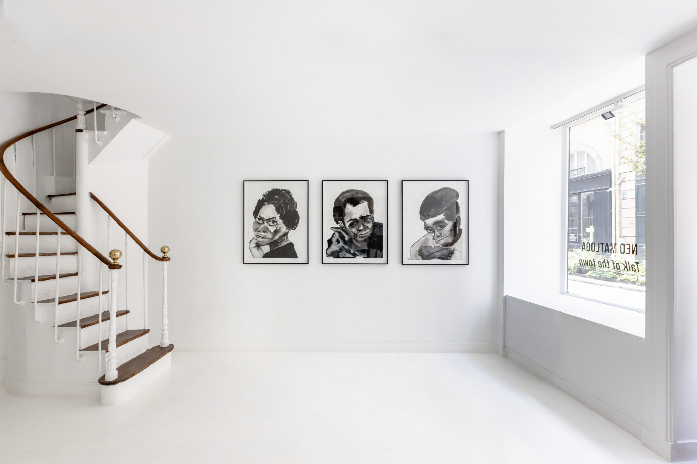
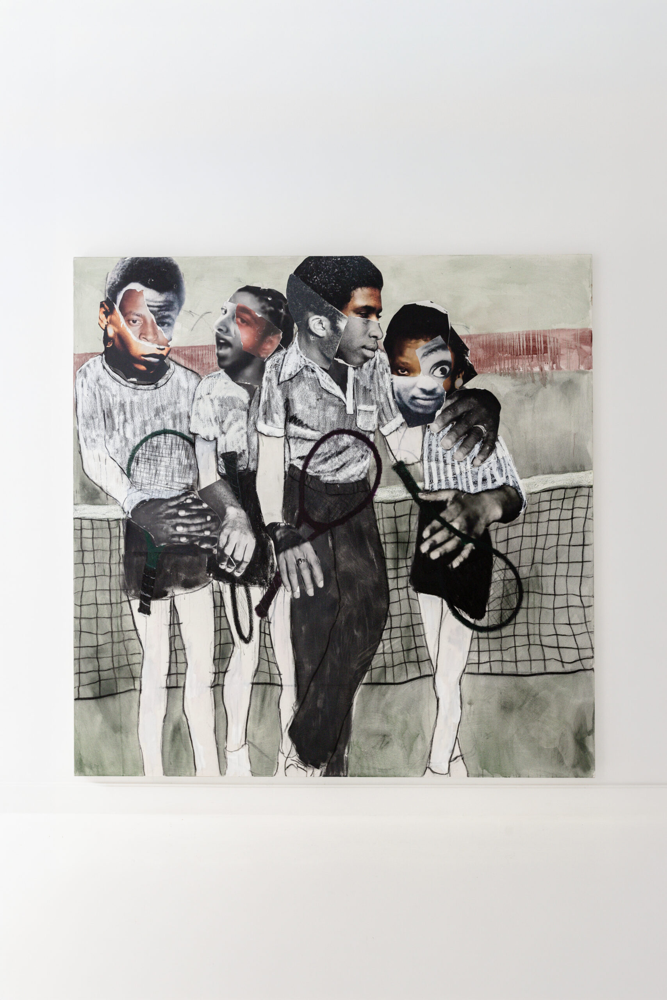
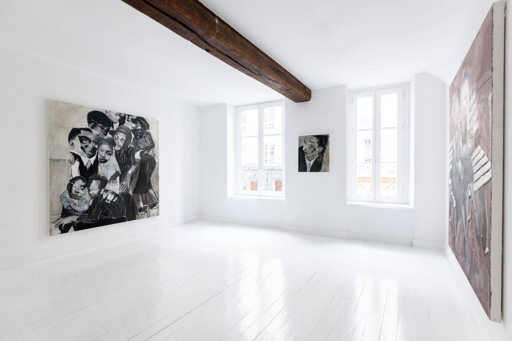

Une grande image à gauche, deux images superposées à droite, puis une photographie sur toute la largeur : voici la disposition en situation avec les photos de l’article [TALK OF THE TOWN](/blog/article_exemple/), consacré à la galerie Dagoma Harty.

<div class="image-mosaic image-mosaic--wide">








</div>

*Photographies reprises de l’article Dagoma Harty. La vue de la salle est utilisée deux fois pour illustrer les quatre emplacements.*

## Reproduire cette disposition

Copiez ce bloc directement dans un fichier `.md` de `src/content/blog/`, à l’endroit où vous souhaitez afficher vos images. Remplacez les chemins et les descriptions par les vôtres. Le CSS est déjà chargé sur le site : aucun import ni composant n’est nécessaire dans l’article.

```markdown
<div class="image-mosaic image-mosaic--wide">


</div>

*Votre légende et vos crédits photographiques.*
```

Gardez **exactement quatre images**, dans cet ordre : la grande image à gauche, le détail en haut à droite, le détail en bas à droite et la vue large en dessous. Pour une autre mosaïque, ajoutez un nouveau bloc complet.

**Conservez les lignes vides** après la balise d’ouverture, entre les images et avant `</div>`. Elles permettent au Markdown de traiter chaque image dans son propre paragraphe. Placez la légende après le bloc pour qu’elle ne devienne pas une case de la grille.

## Largeur, cadrage et mobile

La classe `image-mosaic` crée la grille dans la colonne du texte. Ajoutez `image-mosaic--wide`, comme dans cet exemple, pour élargir la galerie jusqu’à 1 120 pixels tout en gardant une marge sur les côtés.

Sur ordinateur, les photographies remplissent leur emplacement sans être déformées ; leurs bords peuvent être recadrés. Choisissez donc des images dont le sujet reste lisible au centre. À 600 pixels de largeur d’écran ou moins, les quatre photos passent en une seule colonne, dans le même ordre, et retrouvent leur cadrage complet.

Pour modifier l’espace entre les images, ajoutez par exemple `style="--mosaic-gap: 12px;"` sur le `<div>`. L’espacement par défaut est de 8 pixels, avec des angles droits comme dans le modèle.

Les chemins ci-dessus sont relatifs à un article placé directement dans `src/content/blog/`. Adaptez-les si votre article se trouve dans un sous-dossier. En conservant les images dans `src/assets/` et la syntaxe ``, vous gardez l’optimisation des images par Astro.
